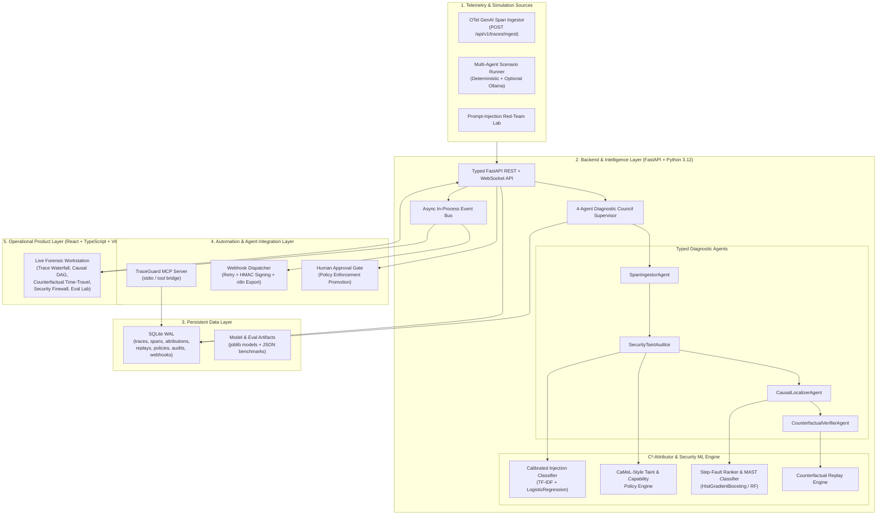

# System Architecture — TraceGuard

## 1. High-Level Interconnected Ecosystem

---

## 2. End-to-End Propagation Workflow (Single Event → Multi-Subsystem Output)

1. **Event Trigger:** An OTel `gen_ai.*` trace arrives at `POST /api/v1/traces/ingest` (or is generated live by the Scenario Runner / Red-Team Lab).
2. **Idempotent Persistence:** Trace & spans are validated via Pydantic v2, deduplicated via `idempotency_key`, and persisted atomically in SQLite WAL.
3. **4-Agent Diagnostic Council Execution:**
   - **Agent 1 (`SpanIngestorAgent`)**: Builds the typed execution DAG, detects structural anomalies (cycles, orphan spans, context drops), and computes graph centrality.
   - **Agent 2 (`SecurityTaintAuditor`)**: Propagates provenance labels (`TRUSTED_USER`, `UNTRUSTED_TOOL`, `SECRET_DATA`), scores untrusted payloads with the trained Injection ML model, and evaluates CaMeL-style capability rules (e.g., *forbid `send_email`/`http_post` if arguments carry `SECRET_DATA` and control flow is tainted by `UNTRUSTED_TOOL`*).
   - **Agent 3 (`CausalLocalizerAgent`)**: Extracts 22 per-step features, runs the trained C³ Step-Fault Ranker & MAST taxonomy classifier, and ranks candidate `(agent, step, mast_mode)` root causes with calibrated probabilities.
   - **Agent 4 (`CounterfactualVerifierAgent`)**: Rewinds the trace to the top attributed step(s), applies surgical interventions (taint sanitization, context restoration, or policy block), replays downstream state transitions, and verifies whether the terminal outcome flips from `FAILED` to `RECOVERED`.
   - **Contradiction Detector (Supervisor):** Flags disagreements between rule-based signals, ML ranker, and counterfactual replay; attaches explicit confidence calibration and diagnostic warnings.
4. **Real-Time & Automated Side Effects:**
   - Publishes typed events (`trace.ingested`, `diagnosis.completed`, `security.alert`, `replay.verified`) over the Event Bus to connected **WebSocket** clients.
   - Dispatches HMAC-SHA256 signed **Webhooks** (n8n-compatible JSON schema) with exponential backoff retry and dead-letter logging when severity >= threshold.
   - Proposes a **Capability Policy Patch** queued in the **Human Approval Gate** (never auto-mutating active production policies without explicit operator approval).

---

## 3. Database Schema (SQLite WAL with Explicit Migrations)

- `traces`: `id`, `external_trace_id`, `idempotency_key` (UNIQUE), `scenario_name`, `framework`, `status` (`PASSED`/`FAILED`/`COMPROMISED`), `root_goal`, `total_tokens`, `total_latency_ms`, `created_at`
- `spans`: `id`, `trace_id`, `step_index`, `parent_span_id`, `agent_name`, `operation_name` (`invoke_agent`/`chat`/`execute_tool`), `tool_name`, `input_text`, `output_text`, `provenance` (`TRUSTED_USER`/`UNTRUSTED_TOOL`/`SECRET_DATA`/`DERIVED`), `tainted` (bool), `latency_ms`, `tokens_in`, `tokens_out`, `status`, `attributes_json`
- `diagnoses`: `id`, `trace_id`, `council_run_id`, `attributed_agent`, `attributed_step_index`, `mast_pillar`, `mast_mode`, `confidence`, `causal_verification_score`, `contradiction_detected`, `security_verdict`, `summary`, `agent_reports_json`, `step_scores_json`, `created_at`
- `counterfactual_replays`: `id`, `trace_id`, `intervention_step_index`, `intervention_type`, `patched_content`, `original_outcome`, `counterfactual_outcome`, `causal_flip` (bool), `delta_score`, `replayed_spans_json`, `created_at`
- `capability_policies`: `id`, `name`, `description`, `rule_json`, `status` (`PENDING_APPROVAL`/`ACTIVE`/`DISABLED`), `created_by`, `approved_by`, `created_at`
- `webhook_deliveries`: `id`, `event_type`, `target_url`, `payload_json`, `hmac_signature`, `status` (`DELIVERED`/`FAILED`/`DEAD_LETTER`), `attempts`, `http_status`, `last_error`, `created_at`
- `audit_logs`: `id`, `actor`, `action`, `resource_type`, `resource_id`, `details_json`, `created_at`

---

## 4. Security & Operational Boundaries
- **API Key / Role Auth:** Bearer token authentication (`X-API-Key` or `Authorization: Bearer`) with `viewer`, `analyst`, and `admin` roles; policy approval & webhook config require `admin`.
- **Prompt Injection Defense:** All retrieved trace payloads are treated strictly as untrusted data, never interpolated into executable shell/SQL/system instructions; optional Ollama narrative synthesis uses strict structural delimiters and output JSON validation.
- **HMAC-Signed Webhooks & Rate Limiting:** Outbound webhooks include `X-TraceGuard-Signature` (HMAC-SHA256) and SSRF-safe URL validation.
- **Graceful Degradation:** If Ollama is unavailable or times out, the entire ML attribution, security firewall, and counterfactual replay pipeline operates deterministically at sub-50ms latency with explicit status reporting.
